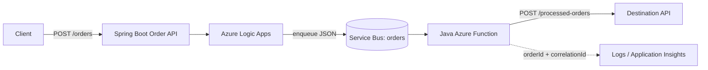

# Architecture

## Key concerns
- Use `orderId` for business identity and `correlationId` for end-to-end tracing.
- Service Bus may redeliver a message; destination processing should be idempotent.
- Configure bounded retries and dead-letter inspection.
- Protect the Logic App HTTP trigger and destination API.
- Use managed identity and least-privilege RBAC where supported; do not log secrets or sensitive payloads.
